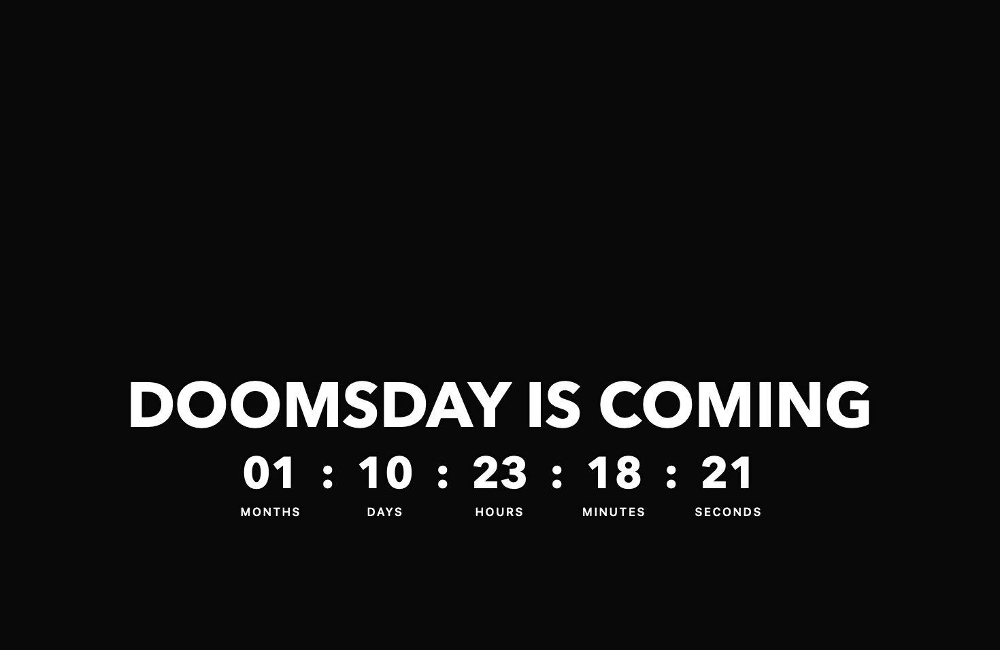

# Doomsday Clock for macOS

Countdown transparan untuk wallpaper Mac, terinspirasi dari Doomsday Clock. Judul dan angka memakai Avenir Next Bold berwarna putih. Angka berukuran 70% dari tinggi judul, dan seluruh teks ditempatkan di atas Dock.



## Pemasangan

1. Unduh **Doomsday-Clock-macOS.zip** dari [rilis terbaru](https://github.com/pterprkrr/doomsday-clock-macos/releases/latest).
2. Ekstrak ZIP, pindahkan **Doomsday Clock.app** ke **Applications**, lalu buka.
3. Tampilkan desktop untuk melihat countdown. Gunakan menu **DOOM** di menu bar untuk mengatur tampilan.

Aplikasi menargetkan macOS 14 (Sonoma) atau lebih baru. ZIP berisi aplikasi universal untuk Apple Silicon dan Intel. Build ini ditandatangani secara ad hoc dan belum dinotariskan Apple. Jika macOS menahan aplikasi saat pertama dibuka, lihat [panduan Apple untuk membuka aplikasi](https://support.apple.com/102445) atau buat aplikasinya dari kode sumber dengan langkah di bawah.

## Penggunaan

- **Wallpaper desktop** menampilkan atau menyembunyikan countdown di atas wallpaper desktop utama.
- **Widget mengambang** membuka countdown yang bisa diseret ke posisi lain.
- **Pratinjau besar** membuka jendela yang bisa ditampilkan layar penuh.
- **Ubah tanggal countdown** mengatur tanggal dan jam dalam WITA (UTC+8). Target bawaan adalah **16 Desember 2026 pukul 00.00 WITA**.

Untuk menjalankan aplikasi saat masuk ke Mac, tambahkan **Doomsday Clock.app** melalui **System Settings → General → Login Items & Extensions → Open at Login**.

## Build dari kode sumber

Siapkan Xcode atau Command Line Tools. Unduh kode sumber lewat **Code → Download ZIP**, ekstrak, lalu jalankan dari folder hasil ekstrak.

```sh
bash build.sh
open 'dist/Doomsday Clock.app'
```

Skrip membuat aplikasi dan ZIP di folder `dist`, lalu memeriksa tanda tangan dan hitungan waktu. Countdown berjalan lokal dan menampilkan bulan kalender, hari, jam, menit, dan detik.

Doomsday Clock adalah proyek dari X.com/pterprkrr. [Referensi konsep dari Marvel Entertainment](https://www.youtube.com/watch?v=f17J3AXVK5w)
